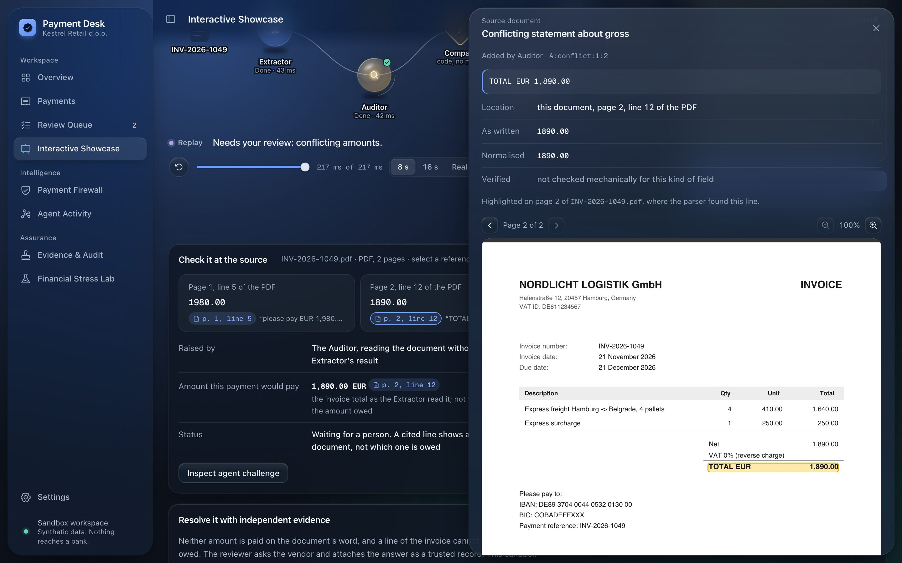
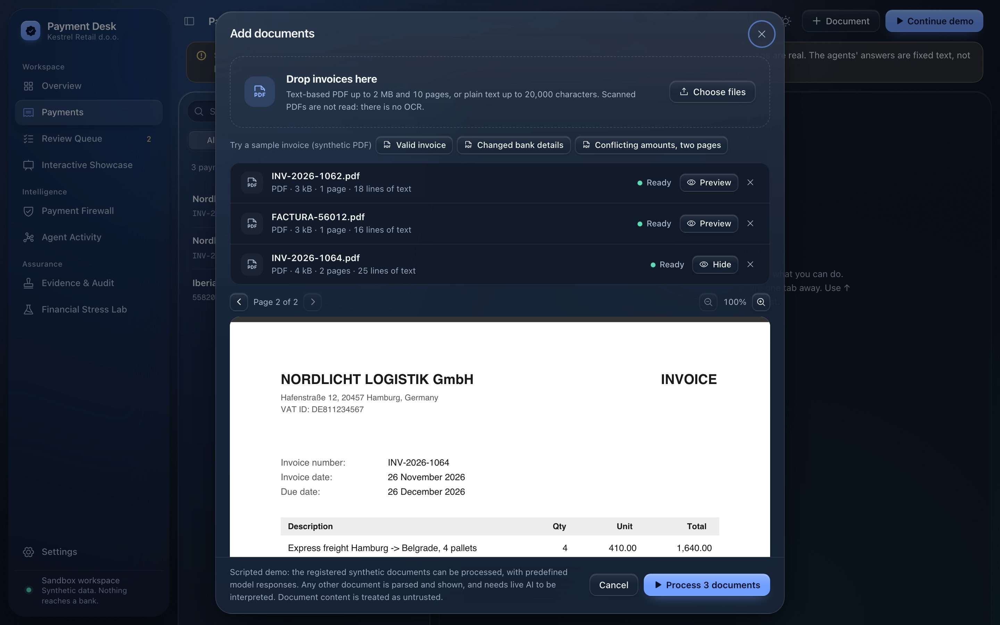

# Payment Desk · PDF intake and page evidence

27 November 2026. What was built after the release of 26 November, what was run, and what was not. No model provider was called in this pass; no credit was bought.

## A. Summary

Invoices arrive as PDF. Until now Payment Desk read plain text only, so every figure pointed at a line of text that the user had to trust was the document.

Now a text-layer PDF can be dropped on the desk. It is validated and parsed on the local machine, goes through the same five-agent Mozaik workflow and the same deterministic controls as a text document, and every located figure carries its page and line. Selecting a reference opens the original page with the cited line marked.

What this is not: there is no OCR, so scanned PDFs are refused. In the scripted demo only registered synthetic PDFs are interpreted. Interpreting any other PDF needs live models, and that has not been run on this version.

## B. Document architecture

| | |
|---|---|
| Parser | `pdfjs-dist` 5.4.624, the legacy build, text layer only. Pinned exactly: later versions exclude Node 20 |
| Where it runs | A worker thread per parse ([`server/pdf-worker.mjs`](server/pdf-worker.mjs)), started and timed by [`server/pdf.ts`](server/pdf.ts). Eval, font loading from the system and XFA forms are off |
| Rendering | In the browser, the same library loaded only when a PDF is opened: one page on a canvas ([`web/src/components/PdfView.tsx`](web/src/components/PdfView.tsx)). No links, forms, attachments or scripts from the file are used |
| Canonical document | The text lines of every page, top to bottom, joined with a newline. This is the document the agents and the controls work on |
| Source map | One entry per text line: page, line number on that page, and a box `[x0, y0, x1, y1]` in page units, or no box when the text is not horizontal or does not lie inside the page |
| Validation | Before parsing: not empty, at most 2 MB, starts with the `%PDF-` signature whatever the name or declared type. During: at most 10 pages, at most 8 seconds, encrypted files refused. After: at least some extractable text (otherwise "no OCR"), at most 20,000 characters |
| Storage | The original bytes by SHA-256, in memory and, when persistence is on, in a folder beside the state file. Read back with the hash checked. If the file is gone, the text and references stay and the interface says the original is unavailable |
| Intake in two steps | `POST /api/documents/inspect` validates and parses and returns what was found with a token; nothing runs. `POST /api/documents {token}` starts the workflow. Pending documents expire after 20 minutes; at most 24 are held |

## C. Financial integration

- **Mozaik.** Unchanged. A PDF becomes a `SourceDocument` with text and a source map and enters the same runtime, agents, events and tools. No agent receives the file.
- **Evidence ledger.** An agent quotes a line; code locates the quote in the text, as before; code then adds the page and the line on that page from the source map. A model never supplies a page number or a position.
- **Integrity verifier.** For a document with a source map, a located reference must point at a line in the map, on a page the document has, and its recorded page must match. Otherwise it is a broken reference, and broken critical evidence blocks the payment as it did before.
- **Duplicates.** Intake distinguishes the same file (same bytes) from another file with the same text. The existing duplicate controls (same invoice, already paid) work on the reading and are unaffected by format.
- **Enforcement.** Not touched. Five invoices were run as text and as PDF and reached the same stage with the same blocking controls. On PDFs: a changed IBAN, wrong arithmetic, a zero amount, a missing IBAN and an unknown vendor are blocked and cannot be approved; instruction-like text is held for a person; a value the document does not state is blocked; a failing agent leaves no approval.

## D. Product experience

- **Add documents.** A large drop zone and a file picker for several files, three sample PDFs, and *Paste text instead* for the previous text flow. Each file appears in a queue as it is validated and parsed: format, size, pages, lines of text, and one of *Ready*, *Duplicate detected*, *Parsed, not processable here* or *Not accepted* with the reason.
- **Preview.** A PDF in the queue opens as the original page, with page navigation and zoom; a text document opens as text.
- **Process.** One explicit action for everything that is ready. Each row then shows its payment's status as the workflow runs, and **Open** goes to the payment.
- **Evidence.** A reference reads `p. 2, line 12`. In the evidence drawer and in the payment's *Evidence* tab the original page is shown with a marker over the cited line; the marker scales with zoom and is absent on other pages. *Extracted text* shows the same line in the text. When no box is known, the page is shown without a marker and a sentence says why.
- **Showcase.** Scenario 3 now runs on a two-page PDF: the cover note on page one asks for 1,980.00 and the invoice on page two totals 1,890.00. The two amounts are labelled with their pages and open there.

Design: the existing tokens and components; a PDF page is paper and stays white in both appearances; the marker is the only new colour (three tokens). The one new animation is the marker appearing, with a reduced-motion path. Checked in dark and light, at 1440 and 375 px.

## E. Without model credit

| | Works with no key and no credit |
|---|---|
| Upload, validation, limits, refusals | Yes, for any file |
| Parsing, page count, text, source map, preview of the original | Yes, for any text-layer PDF |
| Duplicate detection at intake | Yes, for any document |
| The agents' interpretation and the decision | **Only for registered synthetic documents**: sixteen text documents and eight PDFs, recognised by the hash of their extracted text |
| Any other document | Parsed and shown, then: *"The document was parsed successfully. Live AI access is required to interpret this invoice because it is not a registered scripted fixture."* No case is created and nothing is invented |

The scripted workflow on a PDF is the real Mozaik runtime, loops, tools, controls and enforcement with predefined agent answers, as everywhere else in the scripted demo.

## F. Automated testing

| | Before | Now |
|---|---|---|
| `npm test` | 114 of 114, nine files, about 4 s | **130 of 130**, ten files, about 45 s. 0 failed |
| `npm run test:browser` | 17 of 17 | **22 of 22**, three consecutive runs. 0 failed |
| `npm run lab` | 12 of 12 | 12 of 12 |
| `npm run typecheck` | pass | pass |
| `npm run build` | pass | pass. The PDF renderer is a separate chunk (397 kB and a 1.08 MB worker), loaded only when a PDF is opened |

New: `server/test/pdf.test.ts`, sixteen tests (listed as P-01 to P-16 in `TEST_MATRIX.md`); one assertion added to `showcase.test.ts`; five browser checks.

The test suite takes longer than before because each parse starts a worker and loads the library (about half a second each).

## G. CI compatibility

Local, in a clean copy of the repository files with no `node_modules`, `.env`, state or build output:

| | |
|---|---|
| Node 20.20.2 with npm 10.8.2 | `npm ci`, typecheck, 130 tests, build, lab: pass |
| Node 22.23.5 with npm 10.8.2 | `npm ci`, typecheck, 130 tests, build, lab: pass |
| Node 26.8.2 with npm 11 | `npm ci`, typecheck, 130 tests, lab, `npm run demo` with the PDF flow over HTTP, 22 browser checks: pass |

Remote: **not run.** Nothing in this pass has been committed or pushed, so GitHub Actions has not seen it. The last green run is for commit `6cd4727`, before this work. The workflow file is unchanged. The lockfile was updated with npm 10.

## H. Security

- A file is a PDF because of its bytes, not its name or declared type. An executable or an image named `.pdf` is refused.
- Limits: 2 MB, 10 pages, 20,000 characters, 8 seconds, two parses at a time, at most 24 parsed documents waiting on the server. The interface takes eight documents per batch. A parse over time has its worker terminated.
- The parser runs with evaluation off, without system fonts and without XFA. Encrypted PDFs are refused. Nothing in a PDF is executed, followed or fetched.
- Document text remains untrusted content: it is shown as text, and instruction-like lines are flagged and held for a person, on PDFs as on text.
- The original file is served only by document id, with `X-Content-Type-Options: nosniff` and `Content-Security-Policy: sandbox; default-src 'none'`. The browser draws it to a canvas; it is not embedded in a frame.
- The server still listens on the local machine only and refuses requests from other sites.
- Known limits: the parser is a large third-party library processing untrusted input, isolated in a worker thread, not in a separate process or sandbox. There is no malware scanning. `npm audit` reports 0 vulnerabilities with the new dependency.

## I. Visual verification

Looked at in headless Chromium on the scripted server, 1440 × 900 and 375 × 812, dark and light: the intake dialog empty, with a mixed queue (unregistered PDF, broken PDF, executable, text, sample), with a preview, and after processing; the evidence drawer on pages one and two with the marker, zoomed, and on the other page without it; the payment's Evidence tab with the original and with the extracted text; reduced motion. No horizontal overflow at either width; no page error.

Not looked at: Safari and Firefox; a real phone; a keyboard-only pass through the new dialog.

## J. Changed files

New: `server/pdf.ts`, `server/pdf-worker.mjs`, `server/test/minipdf.ts` (a small deterministic PDF writer for fixtures), `server/test/pdf-specs.ts`, `server/test/pdf-fixtures.ts`, `server/test/pdf.test.ts`, `scripts/make-pdf-fixtures.ts`, `server/data/documents/pdf/` (eight PDFs and a manifest, 36 kB), `web/src/components/PdfView.tsx`, `docs/pdf-evidence.jpg`, `docs/pdf-intake.jpg`, this report.

Changed: `server/domain.ts` (source map, page on evidence), `server/desk.ts` (annotation, file store, showcase on the PDF), `server/index.ts` (inspect, pending, samples, file and source endpoints, the scripted registry), `server/integrity.ts`, `server/firewall.ts` (duplicate wording), `server/test/showcase-responses.ts`, `server/test/showcase.test.ts`, `scripts/browser-smoke.mjs`, `web/src/components/AddDocument.tsx` (rewritten), `PaymentDetail.tsx`, `ui.tsx`, `App.tsx`, `web/src/lib/api.ts`, `web/src/views/Showcase.tsx`, `tokens.css`, `views.css`, `package.json`, `package-lock.json` (one dependency: `pdfjs-dist`), and the documentation.

## K. Remaining limitations

- No OCR. Scanned and image-only PDFs, and images, are refused.
- Reading order is top to bottom by baseline. Multi-column pages can be read interleaved; tables are read row by row. Only single-column synthetic invoices were tested.
- The marker covers a line, not a value, and exists only where a box was measured.
- Interpreting a PDF outside the registered set needs live models: **not run**, the provider account has no credit.
- Encrypted PDFs, forms and attachments are not supported.
- CI has not run on this work. Browser checks are local and use Chromium only.
- The four text examples under *Paste text instead* are not registered fixtures, so in the scripted demo they are parsed and not interpreted, like any other unregistered document.

## L. Recommendation

**Conditionally ready to merge.**

For: every gate passes locally on three Node versions from a clean copy; the existing 114 tests and 17 browser checks still pass unchanged in meaning; financial controls were run again on PDFs and hold; nothing is claimed that was not observed.

The conditions: the work is uncommitted, so CI on Linux has not run on it, and the parser is new to that environment; and the submission deadline is today, so a red CI run after a push would need time to fix. Merge if CI is green after the push. If it is not, the release of 26 November (`6cd4727`) is intact and can stay as the submission.
