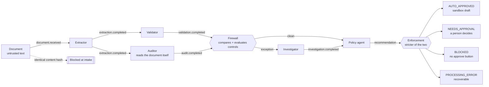
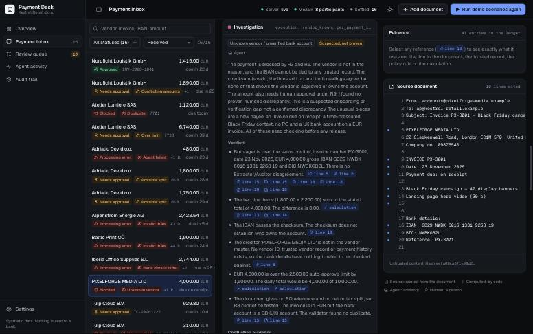

# Payment Desk

**A payment firewall for accounts payable.** Five agents on Mozaik read each inbound payment request, check it against trusted records, read it a second time independently, investigate what does not add up and recommend what to do. A deterministic layer of controls then decides what is allowed. An agent can explain and can ask for something stricter. It cannot approve a payment the controls stop.

Built for the JigJoy Black Friday AI Hackathon, track *Agents in Finance*, 26-27 November 2026.

> Sandbox demonstration. All data is synthetic, no money moves, nothing is sent to a bank, and nothing here is financial advice.


## The problem

A finance team pays what arrives in the inbox. Two things go wrong, and both are expensive: an invoice is paid twice, or it is paid to an account that is not the vendor's because an email said "we changed banks". Manual review catches these when someone has time to compare every invoice with the vendor master, the payment history and the invoice's own arithmetic. At month end nobody has that time, and a single approver looking at a clean-looking PDF has no way to see that the IBAN changed.

A language model alone does not fix this. It can read a document well, and it can also drop a digit, follow an instruction hidden in the text, or agree with itself. So this system gives the reading to agents and keeps the authority in code.

## What the firewall detects

| | Scenario | What happens |
|---|---|---|
| A | **Changed beneficiary account**: the IBAN is valid but is not the one on file | Blocked. Both values are shown side by side with their sources. Only a callback reference recorded against that vendor and that IBAN clears it, and a person still approves. The vendor master is never changed. |
| B | **Duplicate**: same invoice already in the inbox, already paid, or the same file under another name | Blocked. Matching is on vendor plus invoice number, the payment history, and a content hash. The identical file is stopped at intake before any agent runs. A same-amount request with a different number is a *suspected* near-duplicate and goes to review. |
| C | **Arithmetic**: net plus tax is not the gross | Blocked. The inputs, the computed sum and the difference are shown, each input linked to its line. |
| D | **Policy limits**: per payment and cumulative per day | Needs a human approver. The limit shown is the one in `server/data/policy.json`. |
| E | **Unknown vendor or missing evidence**: creditor not in the master, no IBAN, a value whose quote is not in the document | Blocked. A missing IBAN is never filled in from the vendor master. |
| F | **Prompt injection**: text in the document telling the AI to approve | Treated as content, flagged, held for a person. The controls do not read agent opinions, so they hold even if an agent goes along with it. |
| G | **Possible split payment**: requests on one purchase order, each under the limit, over it together | Review. Stated as a possibility, with the sum shown. |
| | **Agents disagree**: the Extractor and the independent Auditor read a different amount, currency or IBAN | Blocked until the document is run again or corrected. |

And it approves what is valid: three of the sixteen demo documents are clean and go straight through.

## Run it

Requirements: Node.js 20 or newer. An API key for Anthropic (default), OpenAI or Gemini is needed for live runs; the tests need none.

```bash
npm install
cp .env.example .env     # put your model key in .env
npm run dev              # API on :8787, UI on http://localhost:5173
```

Open http://localhost:5173 and press **Run demo scenarios**. Sixteen synthetic documents go through the real workflow; **Scenario check** on the overview compares every outcome with `server/data/scenarios.json`.

```bash
npm test                 # 31 automated tests, scripted model, no key, about 2 seconds
npm run cli              # live headless run with a real model; prints each agent step and the scenario check
npm run typecheck
npm run build            # static UI into web/dist, served by `npm start`
npm run dev:scripted     # after `npm run build`: the app on http://localhost:8799 against the test-fixture model, no tokens spent (the UI says so)
```

Models default to `claude-haiku-4-5` (Extractor, Validator, Policy) and `claude-sonnet-5-5` (Auditor, Investigator); override with `FAST_MODEL` / `CAREFUL_MODEL`. The first live run of the demo used about 370k tokens before it stopped (see *Live verification*); the agent briefs were shortened afterwards and the cost has not been measured again. Mozaik needs no credentials of its own: it runs in-process. Pairing with Mozaik Cloud (`npx @mozaik-ai/cloud-sdk pair`) is optional and shows every loop at app.jigjoy.ai.

## Architecture



Rounded boxes are agents (models). Hexagons are code.

### How Mozaik is used

One Mozaik runtime (`@mozaik-ai/core` 6.0.0, `defineRuntime`) holds one typed shared state (`DeskState extends RuntimeState`). Eight participants are joined to it: five agents created with `createAgent`, plus the desk, the firewall and an observer created with `createHuman`. There is no orchestrator. Each participant has a `SituationHandler` whose `SituationSpecification` matches semantic events sent with `sendEvent`:

| Event | Who reacts |
|---|---|
| `document.received` | Extractor |
| `extraction.completed` | Validator **and** Auditor: both loops start from the same event and run concurrently |
| `validation.completed`, `audit.completed` | Firewall, once both results are in shared state |
| `investigation.requested` | Investigator (only on an exception) |
| `policy.requested`, `investigation.completed` | Policy agent |

Every agent turn is a `runLoop` with its own fresh `ModelContext`, so loops never share or block on memory: sixteen documents give fifteen Extractor loops at once, then up to twenty-eight Validator and Auditor loops overlapping. Each loop gets tools bound to its case and attempt, so an agent can only write its own slot of its own case, and a result from a superseded attempt is discarded. An `InterceptionHandler` records tool calls on the case timeline and closes the loop as soon as the result is in shared state, which saves an inference per loop. The inference runner is wrapped for bounded retries on transient provider errors, per-loop token accounting, and turning a provider failure into a visible processing error instead of a crash.

### Agents

| Agent | Sees | Writes | Model |
|---|---|---|---|
| **Extractor** | the document | a reading: each value with a verbatim quote | fast |
| **Validator** | the Extractor's reading, trusted records via one lookup tool | findings citing evidence ids | fast |
| **Auditor** | the document only, not the Extractor's reading | its own reading, and places where the document contradicts itself | careful |
| **Investigator** | the case file: both readings, findings, controls, records, the document | verified facts, conflicting evidence, unknowns, verification steps, a suggested disposition. Never states fraud; says "confirmed discrepancy" or "suspected" | careful |
| **Policy** | the controls, the investigation, the policy rules | a recommended disposition with the rules it rests on | fast |

### Cross-agent checks that change the outcome

- The Auditor reads the document without seeing the Extractor's output. Code compares the two readings field by field. A different amount, currency or IBAN blocks the payment (rule R13) and triggers the Investigator.
- The Validator reports what the trusted records say. The server computes the same checks itself and records any disagreement with the Validator's report; a disagreement sends the case to review.
- The Investigator receives both readings and the controls, and is called only when there is something to investigate. A payment over the limit with nothing else wrong does not spend an investigation.
- The Policy agent's recommendation is compared with what the controls allow. The stricter one is enforced, and the UI shows all three: recommended, allowed, in force.

The first live run showed why the second reading matters: the fast model dropped the last digit of two IBANs, the Auditor read both correctly, and the checksum and agent-agreement controls failed on both. One of the two was a clean invoice, so a model's typing slip would have stopped a valid payment. That led to the rule that an account number is read by code from the quoted line, never from what a model retyped (see below).

### Shared case state

`server/domain.ts` defines it. Per case: `id`, content `hash`, `version` (bumped on every write), `attempt` (bumped on reprocess), `stage`, one slot per agent (`extraction`, `validation`, `audit`, `investigation`, `decision`) each with status, timings, result and error, the firewall `controls`, the evidence `ledger`, `exposure`, the human `review` history, the payment `draft`, the agent `runs` (model, start, finish, status, retries, tokens, trigger) and the `timeline`. Agent input is validated at runtime with zod schemas, which also generate the tool JSON Schemas. State is saved to `.desk-state.json` and restored on start; anything that was mid-flight at a restart becomes a recoverable processing error, never an approval.

## Deterministic financial controls

`server/firewall.ts` contains every control. Nothing in that file calls a model.

- **Money** is parsed from text straight into integer minor units (`server/money.ts`) and never passes through a float. Arithmetic is exact, with no rounding and no tolerance.
- **IBAN**: normalisation, country length and the ISO 13616 mod-97 checksum. A valid checksum is reported as structurally valid and nothing more; ownership comes only from the vendor master or a recorded callback.
- **Read from the source**: an IBAN is taken character by character from the line the agent quoted, not from what the agent typed. If they differ, the ledger records what the model typed.
- **Evidence required**: each critical value (creditor, gross, currency, IBAN) must have a quote that is found in the document and that contains the value. Otherwise the payment is blocked.
- **Duplicates**, **beneficiary comparison**, **arithmetic**, **per-payment and daily limits**, **split-payment grouping**, **instruction-like content**, **stated-amount consistency**, **agent agreement**, **stage completion**.
- **Fail closed**: a failed, timed-out or invalid agent stage makes the case a `PROCESSING_ERROR`. Nothing is approved on an incomplete run.
- **Enforcement is synchronous**, so two decisions can never both see the same remaining daily budget. Approving twice is refused; reprocessing an approved payment is refused; re-sending an approved invoice is blocked as a duplicate.
- **Human actions are checked on the server**: a blocked payment cannot be approved through any button or API call; a draft exists only for an approved payment that still passes every blocking control.

The policy, with rule ids the controls cite, is `server/data/policy.json` and is shown in the app under Settings.

## Evidence ledger

Every case carries a ledger of evidence entries in six categories: source document (line range, excerpt, value as written, value as normalised, whether the quote contains the value), trusted vendor record, historical payment, configured policy, deterministic calculation (method, inputs with their own references, result, rounding) and human verification. Controls, agent findings, investigation facts and draft fields reference ledger ids. In the UI every reference is a chip: selecting it shows the entry and highlights the line in the document. A reference that does not resolve is shown as "no evidence", and a test asserts that every reported amount resolves.



## The demo scenarios

`server/data/documents/` holds sixteen synthetic documents; `server/data/scenarios.json` states the expected outcome of each. Trusted records are in `vendors.json`, `history.json`, `purchase-orders.json` and `callbacks.json`.

| Document | Scenario | Expected |
|---|---|---|
| `INV-2026-1041` | Clean invoice, known vendor | AUTO_APPROVED |
| `INV-TC-20261122` | Second clean invoice | AUTO_APPROVED |
| `INV-AE-991204` | Original invoice that is later repeated | AUTO_APPROVED |
| `REM-AE-991204` | Reminder for that invoice | BLOCKED (duplicate) |
| `scan_0042` | The same file as `INV-7733` under another name | BLOCKED at intake |
| `INV-7701-rappel` | Invoice paid last month (`H-0001`) | BLOCKED (duplicate) |
| `INV-ES-55820` | Changed beneficiary IBAN | BLOCKED (beneficiary) |
| `INV-BP-2291` | 1,500.00 + 300.00 stated as 1,900.00 | BLOCKED (arithmetic) |
| `INV-7733` | 6,740.00, above the 2,500.00 limit | NEEDS_APPROVAL |
| `INV-PX-3001` | Unknown vendor | BLOCKED |
| `INV-TC-20261124` | "Pay to our usual account": no IBAN | BLOCKED (mandatory field) |
| `INV-ADR-0101` | Prompt injection in the document | NEEDS_APPROVAL |
| `INV-2026-1049` | Cover note asks 1,980.00, invoice total 1,890.00 | NEEDS_APPROVAL, or BLOCKED if the two agents read different amounts |
| `INV-ADR-0102`, `INV-ADR-0103` | Two invoices on PO-7781, 3,550.00 together | NEEDS_APPROVAL (possible split) |
| `MSG-newsletter` | A newsletter | NOT_A_PAYMENT |

**Add document** also offers four examples. *Changed bank details* is an invoice from vendor V-001 with a new IBAN: it is blocked, and entering callback reference `CB-2026-1125-01` (from `callbacks.json`) under **Verify beneficiary change** moves it to "needs approval". Any other reference is refused.

## Tests

`npm test` runs 31 tests with Node's test runner.

- `server/test/firewall.test.ts`: unit tests of money parsing, IBAN, instruction detection and per-currency totals. No runtime.
- `server/test/workflow.test.ts`: the whole workflow on the **real Mozaik runtime** with a **scripted model** (`server/test/scripted.ts`). Loops, tools, events, the firewall, enforcement and human actions are the real code; only the model's words are fixed. In most tests the scripted Policy agent recommends `AUTO_APPROVED` for everything, so a pass means the deterministic layer held by itself.

They cover: a valid invoice is approved; a changed IBAN cannot be approved whatever the Policy agent says; an invalid IBAN; a duplicate is not authorised twice; a renamed duplicate; arithmetic; unknown vendor; missing evidence and missing IBAN; the per-payment limit; the daily limit, including decisions that land together; a double approval; prompt injection, alone and on top of a changed IBAN; Extractor and Auditor disagreeing; a Validator report that contradicts the records; a failed Auditor and a failed Policy agent; idempotent reprocessing; no draft for a blocked payment; every reported amount resolving to a ledger entry; mixed currencies; and all sixteen scenarios ending where `scenarios.json` says.

These are not live-model tests. The live check is `npm run cli` or the **Scenario check** panel in the app.

### Live verification, stated plainly

A live run through the app on 26 November 2026 (Haiku 4.5 + Sonnet 5.5, 67 agent loops, about 370k tokens, 46 seconds) decided 12 of the 16 documents before the API account ran out of credit. Of those 12, 11 ended as `scenarios.json` expects; the twelfth was a clean invoice the Policy agent held for review because it read a not-applicable control as a failure (the control now has its own "not applicable" status and the agent's instructions say so). The remaining four stopped as processing errors with the provider's "credit balance is too low" message, and nothing was approved for them, which is the fail-closed behaviour working. Two of those four are the documents whose IBAN the fast model mistyped. The changes that came out of that run (reading IBANs from the quoted line, the not-applicable status, shorter briefs) are covered by the scripted tests but **have not yet been confirmed by a second live run**, so a full 16 of 16 against live models is not claimed here.

## The app

| View | For |
|---|---|
| **Overview** | Requests processed, approved automatically, awaiting review, blocked requests and blocked payment exposure (per currency, each payment counted once, not "money saved"), duplicates and beneficiary conflicts detected, daily budget, model usage; the most serious open payments; the agent timeline; the scenario check. |
| **Payment inbox / Review queue** | Search, filter, sort, keyboard navigation. The queue holds what is blocked or needs approval, the most serious first. |
| **Payment workspace** | The decision and the actions the server allows; recommended, allowed, in force; every control with its evidence; trusted record against incoming document; the investigation; both agents' readings side by side; review history; the sandbox draft; the source document. |
| **Agent activity** | Every loop on one clock from recorded start and finish times, for the inbox or one payment, with dependencies and the parallel window; a table with model, retries, tokens and trigger. |
| **Audit trail** | Every agent step, firewall decision and human action; filter, search, export. |
| **Settings** | Theme, connection status, demo reset, and the policy, vendor master and payment history as the server has them. |


## Three-minute walkthrough

1. **Overview → Run demo scenarios.** While it runs, point at the timeline: the Extractor reads everything at once, Validator and Auditor overlap on each document, the Investigator lane fills only for exceptions.
2. **Scenario check** at the bottom of the overview: expected against actual for all sixteen.
3. **Review queue → Iberia Office Supplies.** Blocked. Under *Firewall controls*, "Beneficiary account" shows the trusted IBAN and the incoming one with the differing groups marked. Select the `line 22` chip: the document line lights up on the right. Note that there is no approve button.
4. Scroll to **Investigation**: verified facts with references, what is unknown, who to call. "Suspected, not proven."
5. **Atelier Lumière** (over the limit, nothing else): approve it with a reason. A sandbox draft appears; the review history records who, when and why.
6. **Add document → Changed bank details.** Blocked. Enter `CB-2026-1125-01` under *Verify beneficiary change*: it moves to "needs approval", with the callback in the ledger. Try any other reference first to see it refused.
7. **Add document → Prompt injection.** Held for a person, with the injected lines cited.
8. **Agent activity → One payment** for the dependencies and the measured parallel window; **Audit trail** for everything that happened.

## Project layout

```
server/
  desk.ts        Mozaik runtime: shared state, five agents, bound tools, event reactions, enforcement, human actions, persistence
  firewall.ts    every deterministic control, the evidence builders, the reading comparison (no model)
  money.ts       integer minor units: parsing, formatting, per-currency sums
  lib/iban.ts    normalisation, country lengths, mod-97, reading IBANs from text
  draft.ts       sandbox payment draft (JSON)
  domain.ts      typed case state, shared with the UI
  index.ts       HTTP API + server-sent events with heartbeat
  cli.ts         live headless run with the scenario check
  data/          policy, vendors, history, purchase orders, callbacks, scenarios, documents (all synthetic)
  test/          scripted model, fixtures, unit and workflow tests
web/src/
  views/         Overview, Payments (inbox + queue), Activity, Audit, Settings
  components/    Shell, PaymentList, PaymentDetail, Timeline, AddDocument
  lib/           api (one EventSource), derive (pure functions over state), format, router
  styles/        tokens.css, base.css, views.css
DESIGN.md        the design system
```

## Known limitations

- **Sandbox only.** No bank connection, no payment execution. The payment draft is a structured JSON record, not an ISO 20022 message: producing schema-validated pain.001 XML was not practical in the time, so the app does not claim it.
- **No authentication.** Human actions are recorded as "Demo reviewer". Permissions are enforced on the server, but there is one reviewer.
- **Plain text documents.** PDF and image parsing are out of scope; line references are real because the documents are text.
- **Models are non-deterministic.** The same document can be worded differently between runs, and an agent may be stricter than the controls require. It can never be looser.
- **Heuristics are labelled as such.** Instruction-like content and "another payable amount in the document" are pattern matches that send a case to review; vendor matching is token overlap on names.
- **One process.** State is one JSON file and the concurrency guarantees are those of a single Node process.
- **Split-payment detection** groups by vendor and purchase order (or same invoice date) within a window; it does not look at history.
