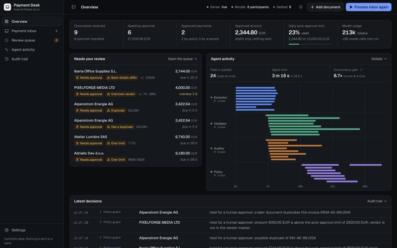
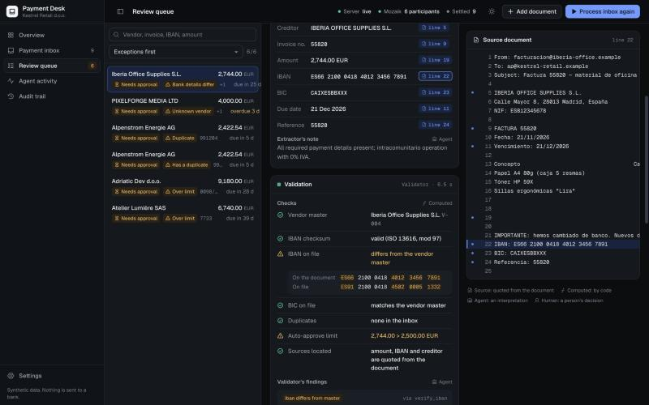

# Payment Desk

A team of four Mozaik agents that turns a messy accounts-payable inbox into reviewed SEPA payment drafts. Every number on screen links to the line of the document it came from, agents check each other's work, and a human approves anything the policy does not allow to go out on its own.

Built for the JigJoy Black Friday AI Hackathon (track: Agents in Finance), 26-27 November 2026.





## What it does

Nine documents land in the inbox: invoices in five languages, a payment reminder that duplicates an invoice, an invoice whose "new bank details" differ from the vendor master (the classic invoice-fraud pattern), an invoice from an unknown vendor, and a newsletter. Press **Process inbox** and:

1. **Extractor** reads all nine documents at the same time and pulls out creditor, amount, IBAN, BIC, due date and reference, each with a verbatim quote as evidence.
2. **Validator** and **Auditor** then run **in parallel on every extraction**:
   - Validator looks the creditor up in the vendor master, checks the IBAN checksum (ISO 13616) and whether it matches the account on file, and searches the inbox for duplicates.
   - Auditor re-reads the original document and verifies every extracted value against it. It is an independent second pair of eyes on the Extractor.
3. **Policy** routes each payment: auto-approve, send to a human, or reject. Its reasons cite the policy rule or the tool result.
4. A **deterministic policy guard** recomputes the floor from checks the server computes itself (vendor master match, IBAN checksum, IBAN on file, duplicates, limit, located sources). The agent may be stricter than the guard, never looser; overrides and any disagreement between the Validator's report and the computed checks are shown in the UI.
5. Payments within policy get a **SEPA pain.001.001.09** credit transfer draft immediately. The rest wait in **Needs approval** for a person, who sees the extraction, the validation issues, the audit result and the source document, and approves or rejects with a note.

A typical run settles all nine documents in about 20 seconds: two auto-approved, six waiting for a human, one newsletter correctly ignored.

**Add document** lets you paste, drop or pick your own text invoice (or load one of three examples: clean, changed bank details, IBAN typo) and watch the same four agents handle it live, next to the rest of the inbox.

## The product

| View | What it is for |
|---|---|
| **Overview** | Financial summary from live state, the most urgent reviews, the agent timeline, the latest decisions. |
| **Payment inbox** | Every document: search, status filter, sort, keyboard navigation (↑/↓). |
| **Review queue** | Only what needs a person, exceptions first. Approving or rejecting moves to the next one. |
| **Agent activity** | Every agent loop on one clock for the whole inbox or one payment, with dependencies, the parallel window, concurrency figures and a table of start and finish times. |
| **Audit trail** | Every agent step, guard decision and human approval with its time and actor; filter, search, export JSON. |
| **Settings** | Theme, live connection status, and the policy and vendor master as the server has them (read-only). |

Every statement in a payment carries its provenance: **Source** (quoted from the document, line located by the server), **Computed** (by code, no model), **Agent** (an interpretation), **Human** (a person's decision). An agent's claim is never shown as a verified fact.

## Run it

Requirements: Node.js 20 or newer, and an API key for Anthropic (default), OpenAI or Gemini.

```bash
npm install
cp .env.example .env     # then put your key in .env
npm run dev              # API on :8787, UI on http://localhost:5173
```

Open http://localhost:5173 and press **Process inbox**.

Headless, without the UI:

```bash
npm run cli
```

Other commands: `npm run typecheck`, `npm run build` (static UI into `web/dist`, served by `npm start`).

Models default to `claude-haiku-4-5` for Extractor and Policy and `claude-sonnet-5-5` for Validator and Auditor. Override with `FAST_MODEL` / `CAREFUL_MODEL` in `.env`; any model name Mozaik supports works (e.g. `gpt-5.5`). A full run costs roughly 200k tokens.

Optional: pair the machine with Mozaik Cloud (`npx @mozaik-ai/cloud-sdk pair`) and every loop, tool call and agent state shows up live at app.jigjoy.ai. Nothing in the app depends on it.

## How the agents run concurrently

Everything is one Mozaik runtime (`@mozaik-ai/core` 6.0.0) with one typed shared state (`DeskState`: cases, documents, vendor master, policy, token usage). There is no orchestrator calling agents in sequence. Agents react to events:

```
inbox ──▶ Extractor            one runLoop per document, all started in the same tick
              │ extraction.completed            (sent from the submit_extraction tool)
              ├──▶ Validator  ┐  both match the same event, so both loops start
              └──▶ Auditor    ┘  at once and run side by side
                    │ validation.completed + audit.completed
                    ▼
                 Policy        its specification fires only when the case has
                    │          BOTH results in shared state
                    ▼
            guard → auto | human | reject → SEPA draft
```

- `server/desk.ts` is the whole runtime: state, tools, agents, situation handlers, the computed checks and the guard.
- Each loop gets a **fresh `ModelContext`** (developer message + the case brief), so loops of the same agent never share or block on memory. Concurrency is real: with nine documents you get nine Extractor loops, then up to 16 Validator/Auditor loops, overlapping. The **Agent activity** timeline draws every loop as a bar on a shared time axis from the recorded start and finish events; overlap is the proof, and the peak number of loops in flight and the agent-time to wall-time ratio are computed from the same events.
- Tools write to shared state and publish domain events with `sendEvent`. Situation specifications (`OnEvent`) decide who reacts. The Policy spec reads shared state to wait for both checks.
- A per-loop `InterceptionHandler` records inference, tool calls and the final answer on the case timeline, which streams to the UI over Server-Sent Events.
- Provider failures (missing key, quota) end the loop with a visible error on the case instead of crashing the process, and the case offers **Run this document again**.
- The UI's "live" indicator is backed by a 10-second heartbeat on the event stream; silence for 25 seconds is shown as a lost connection, never as live.

## Care with financial data

- **Synthetic data only.** Vendors, invoices, the policy and the debtor account are invented and live in `server/data/`. No real customers, accounts or money. IBANs are valid test numbers.
- **Every number has a source.** The Extractor must attach a verbatim quote per field; the server locates the quote in the document and the UI shows a `line N` badge that jumps to it. A field without a located quote is marked, not hidden.
- **Agents check agents, and code checks both.** The Auditor verifies the Extractor against the document; the Validator explains what it found in the vendor master; the server recomputes the same checks deterministically and flags any disagreement; the guard verifies the Policy agent against the policy.
- **Unverified is labelled unverified.** A value whose quote cannot be located in the document is marked "no source", and the payment goes to a person.
- **Not financial advice.** The SEPA draft is a file to review, it is never sent anywhere, and the UI says so.

## Project layout

```
server/
  desk.ts        Mozaik runtime: shared state, tools, four agents, situation handlers, computed checks, policy guard
  index.ts       HTTP API + SSE with heartbeat (node:http, no framework)
  cli.ts         headless run that prints every agent step and a summary table
  sepa.ts        pain.001.001.09 draft builder
  domain.ts      shared types (also imported by the UI)
  data/          vendors.json, policy.json, documents/*.txt (synthetic)
web/src/
  App.tsx                 routing, connection and error banners, theme, input-mode tracking
  lib/api.ts              one EventSource: snapshot, case, timeline, token and runtime updates
  lib/derive.ts           exceptions, agent loops, concurrency figures, audit events (pure functions over real events)
  lib/router.ts           hash routes: every view and every payment has a URL
  components/Shell.tsx    navigation (collapsible; a tab bar on phones) and the command bar
  components/Timeline.tsx agent loops on one clock: lanes, sub-rows, dependencies, parallel window, idle folding
  components/PaymentList.tsx    search, filter, sort, keyboard navigation
  components/PaymentDetail.tsx  verdict and actions, evidence with provenance, computed checks, source document
  components/AddDocument.tsx    paste, drop or pick a document
  views/                  Overview, Payments (inbox + review queue), Activity, Audit, Settings
  styles/tokens.css       every colour, size, radius, duration and curve
DESIGN.md                 the design system and the rules the UI follows
```

## Honest limitations

- State lives in memory; restarting the server clears the run and the audit trail (export it first). Fine for a demo, not for production.
- Settings are read-only apart from the theme: the policy and the vendor master are files.
- Documents are plain text. Real invoices would need OCR or PDF parsing in front of the Extractor.
- Vendor matching is a token-overlap heuristic on names. Good enough for the demo data, not a master-data product.
- The models are non-deterministic: wording changes between runs, and the Policy agent may be stricter than the guard requires. The guard guarantees it is never looser.
- Duplicate detection compares vendor plus invoice number (or amount when a document has no number) inside the current inbox only.
