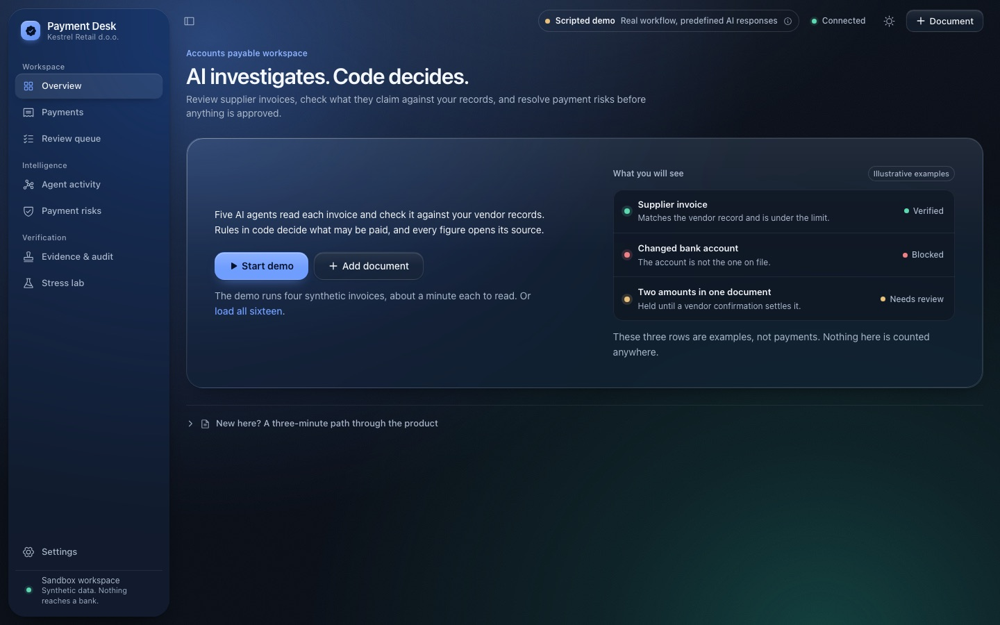
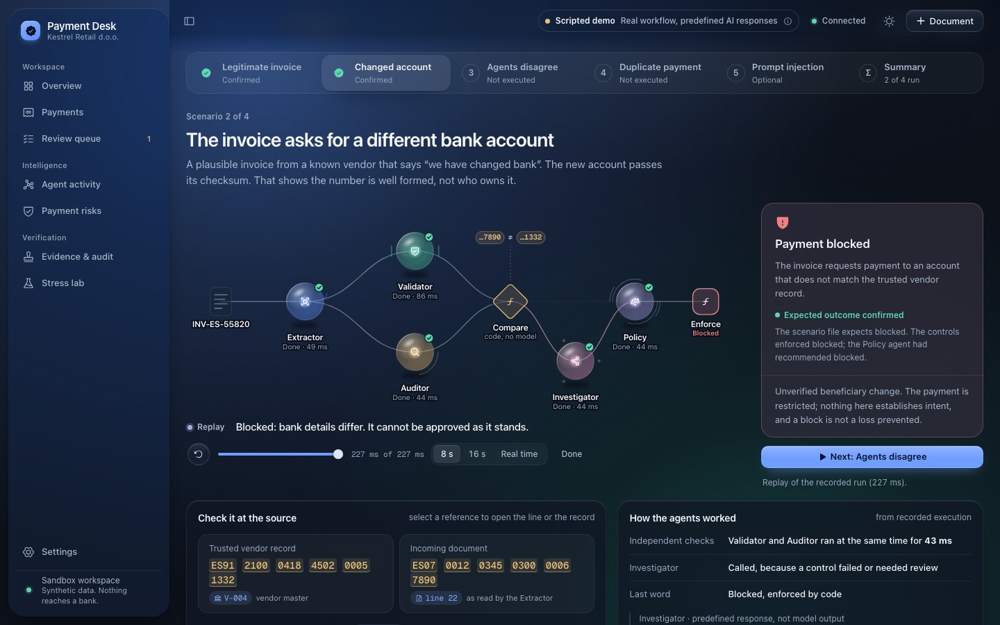
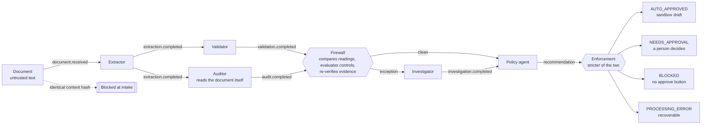

# Payment Desk

**AI investigates. Code decides.**

[](https://github.com/lukovic75/payment-desk/actions/workflows/ci.yml)


Payment Desk checks supplier invoices before they are paid. Five agents on one [Mozaik](https://docs.jigjoy.ai) runtime read each document, check it against trusted records, read it a second time independently and investigate what does not add up. Deterministic code then decides what may be approved, and every figure opens the line, PDF page, record or calculation it came from.

For accounts payable teams, finance operations and finance managers: anyone who decides, invoice by invoice, whether a payment may go out.

> Sandbox. All data is synthetic, no money moves, nothing is sent to a bank, and nothing here is financial advice. Built for the JigJoy Black Friday AI Hackathon, *Agents in Finance*, 26 to 27 November 2026.

| Start here | |
|---|---|
| **Open it** | There is no hosted link: it runs on your computer. `npm ci && npm run demo`, then http://localhost:8799. [Step by step below](#how-to-open-the-application) |
| **Watch it** | [Video, two and a half minutes](docs/demo/payment-desk-demo.mp4): the running application, captions, no narration |
| **Judge it** | [`JUDGE_QUICKSTART.md`](JUDGE_QUICKSTART.md): ten workflows with exact steps and expected results |
| **Check the claims** | [`ARCHITECTURE_PROOF.md`](ARCHITECTURE_PROOF.md), claim by claim with code and tests |
| **Public deployment** | None. [`DEPLOYMENT.md`](DEPLOYMENT.md) says why, and how to run the same thing in a container |

## How to open the application

**There is no public URL and no login.** Payment Desk runs on your own computer and you open it in your browser at **http://localhost:8799**. No API key, no account, no model, no database, no `.env` file. Most of the wait is the one-time install.

### What you need

| | |
|---|---|
| **Node.js** | 20.19 or newer in the 20 line, or 22.12 or newer. Check with `node -v`. npm comes with it |
| **The code** | `git clone`, or on GitHub **Code → Download ZIP** and unpack it |
| **A browser** | Chrome, Edge or another Chromium browser is what the automated checks ran in |
| **Internet** | once, for `npm ci`. After that nothing leaves your machine |
| **System** | macOS or Linux. On Windows use WSL, or the Docker option below: the npm scripts set environment variables the POSIX way |

### Steps

**1. Get the code**

```bash
git clone https://github.com/lukovic75/payment-desk.git
cd payment-desk
```

**2. Install**

```bash
npm ci
```

**3. Start**

```bash
npm run demo
```

This builds the interface and starts the server. It is ready when the terminal prints these two lines:

```text
Payment Desk API on http://localhost:8799  (scripted model: real orchestration, predefined model responses)
Open http://localhost:8799/#/showcase
```

Leave that terminal open: closing it stops the application. A build notice about chunk size just above those lines is harmless.

**4. Open http://localhost:8799 in your browser**

You see the Overview, with the indicator **Scripted demo** at the top right:



**5. Run the demo**

1. Press **Start demo**. The guided demo opens.
2. Press **Start demo** again on that screen. The first invoice is processed and ends in *Payment verified*.
3. Continue with **Next: Changed account**, **Next: Agents disagree** and **Next: Duplicate payment**.

In this mode each scenario is processed within seconds; allow about a minute to read each result. [`JUDGE_QUICKSTART.md`](JUDGE_QUICKSTART.md) lists ten workflows with the exact buttons and the result to expect from each.

**6. Stop and reset**

Press `Ctrl+C` in the terminal to stop. Nothing is saved to disk in this mode, so `npm run demo` always starts from the same clean state. **Restart** at the top of the guided demo starts the four scenarios over without stopping the server.

### If it does not open

Run `npm run doctor` first: it checks Node, the install, the dataset and the port, and says what is missing.

| What you see | What it means | What to do |
|---|---|---|
| `Error: listen EADDRINUSE: address already in use 127.0.0.1:8799` | Another program uses port 8799, or the demo is already running in another terminal | Open http://localhost:8799 to see whether it is already there. Otherwise stop the other program, or use another port (below) |
| The browser cannot connect | The two ready lines have not been printed yet, or the terminal was closed | Wait for them, or run `npm run demo` again. The address starts with `http://`, not `https://` |
| It opens on this computer but not from a phone or another machine | Intended: the server answers only on the machine it runs on, because there is no login | Open it on the same computer |
| `npm ci` warns about the engine, or the build fails | Node is probably too old | `node -v`, then install Node 20.19+ or 22.12+ |
| On Windows, the start command fails at `DESK_SCRIPTED=1` | The Windows shell does not set variables that way (not tested on Windows) | Use WSL or Docker |

On another port, here 8800 (then open http://localhost:8800):

```bash
npm run build && API_PORT=8800 DESK_SCRIPTED=1 DESK_PERSIST=off MOZAIK_CREDENTIALS_FILE=/nonexistent npx tsx server/index.ts
```

### Without Node: Docker

```bash
docker build -t payment-desk .
docker run --rm -p 127.0.0.1:8799:8799 payment-desk
```

Then open the same address, http://localhost:8799. It is the same no-key demo; `Ctrl+C` stops it. The container prints one extra line saying it listens on `0.0.0.0`: that is inside the container, and the `127.0.0.1:` in the command keeps it reachable from your machine only.

### Without running anything

[The video](docs/demo/payment-desk-demo.mp4) shows the running application in two and a half minutes, and [`docs/evidence/`](docs/evidence) holds twelve current screenshots.

## What it looks like



More: [`docs/evidence/`](docs/evidence) (twelve current screenshots).

## The problem

Finance teams pay what arrives in the inbox. The expensive mistakes are ordinary ones: an invoice paid twice, a payment sent to a new account because a message said the bank had changed, a total that is not the sum of its parts, a cover note that asks for a different amount than the invoice.

One language model reading the invoice does not solve this. It can misread a value and then validate, explain and approve its own misreading. And a model's recommendation is not an authorization.

## The solution

Receive → extract → verify independently → investigate discrepancies → apply deterministic controls → ask a person where the policy wants one → prepare a sandbox payment draft.

- **Agents investigate and recommend.** They read, look up records, challenge each other and explain.
- **Code decides.** What is in force is the stricter of the recommendation and what the controls allow. A blocked payment cannot be approved by an agent, by a person or by a direct API call.
- **Every figure has a source.** Code reads the cited line again before anything is approved.
- **Nothing is paid.** Approval writes a JSON draft marked as sandbox.

## Why five agents, and why Mozaik

One Mozaik runtime (`@mozaik-ai/core`, `defineRuntime`), one typed shared case state, five agents subscribed to semantic events. No orchestrator calls them in order: the runtime starts a loop when its event is published.

| Agent | Receives | Adds to the shared case |
|---|---|---|
| **Extractor** | the document | a reading: each value with the line it is quoted from |
| **Validator** | the Extractor's reading and a lookup tool for trusted records | vendor match, account match, duplicates, each with evidence |
| **Auditor** | the document, **and nothing the Extractor produced** | an independent second reading, and contradictions inside the document |
| **Investigator** | the case file, only when a control fails or two findings disagree | what is verified, what conflicts, what is unknown, what to check next |
| **Policy** | controls, investigation, policy rules | a recommended disposition |

The Validator and the Auditor are two subscribers of the same event, `extraction.completed`, so both loops start together and overlap. The Auditor is independent by input, not by instruction: a test checks that its input holds nothing from the first reading. Where the two readings or the records disagree, code stores a structured challenge with the evidence for each side; that is what starts the Investigator.



Rounded boxes are agents (models). Hexagons are code. Where to look: [`server/desk.ts`](server/desk.ts) (runtime, agents, events, enforcement), [`server/firewall.ts`](server/firewall.ts) (controls), [`server/challenges.ts`](server/challenges.ts), [`server/integrity.ts`](server/integrity.ts); tests `workflow.test.ts` (recorded intervals overlap) and `intelligence.test.ts` (the Auditor's input). One distinction: with a local model served one request at a time, the two loops overlap and their model calls do not.

## What has been demonstrated

Each row is a different kind of evidence. They are never added into one figure.

| Kind | What ran | Result |
|---|---|---|
| **Scripted** (real runtime, predefined model answers) | 166 automated tests, 12 stress scenarios, 32 browser checks; CI on Node 20 and 22 | all pass |
| **Controlled fault injection** (errors put into agent answers on purpose) | 9 injected errors, each with one agent and with five | 7 stopped by code either way; 1 stopped only by the independent second reading; 1 not caught, declared as a limit |
| **Real local model**, showcase (`qwen2.5:7b-instruct`, a laptop) | 4 scenarios on the final code | 4 of 4 as expected. Two earlier runs the same day: 2 of 4 and 3 of 4, both kept |
| **Real local model**, held-out invoices | 5 unseen documents, one run | 4 of 5 as declared in advance; 24 of 25 critical fields; the Auditor found a second amount that code missed; code blocked an amount the Extractor invented |
| **Real local model**, benchmark | single agent against five, 5 of 10 scenarios, one run | 3 of 5 against 4 of 5; no unsafe approval in either; five agents took twice the time |
| **Real hosted models** (earlier code, 26 November) | 5 documents, recorded | 3 decided before the provider credit ran out. Not run on the current code |

The details, including everything that went wrong, are in [`docs/REFERENCE.md`](docs/REFERENCE.md#real-model-runs-of-this-version-27-november-2026). Three stored runs replay in the app from the opening screen of the guided demo.

## What you are running

`npm run demo` ([how to open it](#how-to-open-the-application)) starts the **scripted demo**: the Mozaik runtime, the five agent loops, their tools, the shared state, the controls and the enforcement run for real. What the agents answer is predefined text, and the indicator at the top of every page says so. It shows how the system behaves; it does not show how well a model reads an invoice, and it interprets only its registered synthetic documents.

### Real AI on your own machine, still without a key

```bash
ollama pull qwen2.5:7b-instruct        # about 4.7 GB
printf 'FROM qwen2.5:7b-instruct\nPARAMETER num_ctx 12288\nPARAMETER temperature 0\n' > Modelfile
ollama create qwen2.5:7b-instruct-12k -f Modelfile
LOCAL_MODEL=qwen2.5:7b-instruct-12k npm run demo:local   # http://localhost:8798, says "Live local AI"
```

Any document can then be uploaded and is read by the model. Expect about four minutes a document on a 16 GB laptop. If the model server is not running or does not have the model, the application says so and stops; it never switches to predefined answers.

### Execution modes

| Mode | Command | Key | A model runs | Reads any document | Status |
|---|---|---|---|---|---|
| Scripted demo | `npm run demo` | no | no | no, registered documents only | verified: tests, browser checks, fresh clone |
| Real local AI | `npm run demo:local` | no | yes, on your machine | yes | verified on `qwen2.5:7b-instruct`: showcase 4 of 4, held-out 4 of 5 |
| Real hosted AI | `npm run dev` with a provider key in `.env` | yes | yes | yes | **not verified on this version** (no provider credit) |
| Recorded runs | in the app, guided demo opening | no | no, a stored run is replayed | no | three recordings, each labelled with model, date and code |
| Public deployment | none | | | | not deployed: see [`DEPLOYMENT.md`](DEPLOYMENT.md) |

Mozaik runs for real in the first three. Only the source of the agents' words differs.

## Verify it

```bash
npm run verify         # typecheck, tests, build, stress scenarios, fault-injection test, in one go
npm run test:browser   # 32 browser checks; needs Node 22+ and a local Chrome or Chromium
```

| Command | What it shows | What it does not show |
|---|---|---|
| `npm test` | 166 tests on the real runtime: workflow, controls at the edges, malformed model output, resolution with trusted records, PDF intake | model quality: the model is scripted |
| `npm run lab` | 12 stress scenarios, each in its own process, each judged against what it declared beforehand | the same |
| `npm run experiment` | which component catches each of 9 injected agent errors | how often a model makes them |
| `npm run test:browser` | the guided demo, PDF evidence, decision report, recordings, provider-failure state in a real browser | other browsers than Chromium |
| `npm run heldout -- http://localhost:8798` | five unseen invoices against a server with a real model | anything on the scripted server: it refuses them, which is the point |
| `npm run lab -- --benchmark` | single agent against five, real models only | a rate: ten scenarios is too few |

## Repository map

| Path | What is there |
|---|---|
| [`server/desk.ts`](server/desk.ts) | the Mozaik runtime: shared state, agents, tools, event reactions, enforcement, review actions |
| [`server/firewall.ts`](server/firewall.ts) | the deterministic controls and the evidence each one rests on |
| [`server/integrity.ts`](server/integrity.ts), [`server/report.ts`](server/report.ts) | re-verification of every value; the decision report and the operational summary |
| [`server/local.ts`](server/local.ts) | local inference (Ollama or any OpenAI-compatible local server), no fallback |
| [`server/lab/`](server/lab) | stress scenarios, benchmark, fault-injection test |
| [`server/pdf.ts`](server/pdf.ts) | text-layer PDF intake with page and line positions |
| [`server/data/`](server/data) | the synthetic dataset, policy, trusted records, stored recordings |
| [`server/test/`](server/test) | thirteen test files |
| [`web/src/`](web/src) | the interface (React, Vite) |
| [`scripts/`](scripts) | browser checks, held-out runner, doctor, fixture generators |

## Data, safety and limits

- **Synthetic data only**, written for this project. [`DATA_PROVENANCE.md`](DATA_PROVENANCE.md) lists every file and identifier. Account numbers are provider test numbers or documentation examples; none is claimed to be unused, and the application cannot reach an account.
- **No bank, no supplier, no payment.** Trusted records are fixture files; a "vendor confirmation" is a row in one of them, not a phone call.
- **A real model is slow here and raises false alarms.** About four minutes a document on a laptop. The local Auditor reported contradictions that were not ones; code removes the kinds it has seen and records that it did.
- **Field meaning is checked by labels and a second reading, not understood by code.** One fault-injection case gets through both, and the test says so.
- **Documents:** plain text and PDFs with a text layer. No OCR.
- **One reviewer, no sign-in, one workspace.** It is a local sandbox, which is why there is no public deployment.
- **Not measured:** time or money saved. No person has been timed using it.

Everything else: [`docs/REFERENCE.md`](docs/REFERENCE.md) (the full reference), [`JUDGE_QA.md`](JUDGE_QA.md) (likely questions), [`TEST_MATRIX.md`](TEST_MATRIX.md), [`HACKATHON_SCORECARD.md`](HACKATHON_SCORECARD.md) (self-assessment), [`DEMO_GUIDE.md`](DEMO_GUIDE.md).
