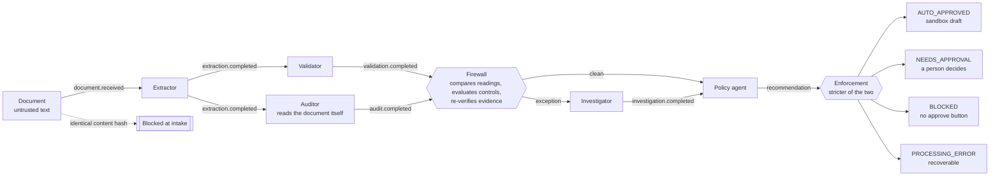
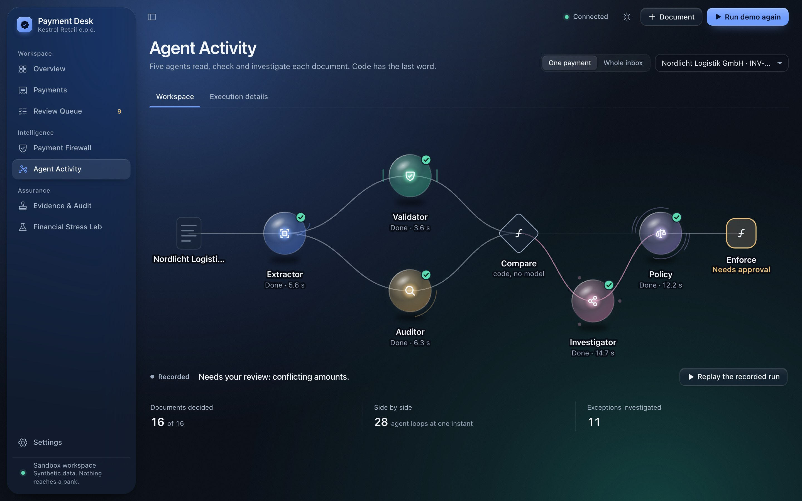
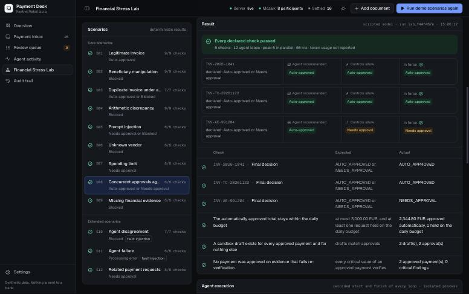

# Payment Desk

**Payment Desk is an evidence-driven multi-agent financial operations platform that investigates, verifies, and controls payment requests before money moves.**

Five agents on Mozaik read each inbound payment request, check it against trusted records, read it a second time independently, investigate what does not add up and recommend what to do. A deterministic payment firewall then decides what is allowed. An agent can explain and can ask for something stricter. It cannot approve a payment the controls stop.

Built for the JigJoy Black Friday AI Hackathon, track *Agents in Finance*, 26-27 November 2026.

> Sandbox demonstration. All data is synthetic, no money moves, nothing is sent to a bank, and nothing here is financial advice.


## Try it in two minutes, without an API key

```bash
npm install
npm test                 # 46 automated tests on the real Mozaik runtime with a scripted model, about 3 seconds
npm run lab              # the 12 stress scenarios from the terminal, scripted model, a few seconds
```

With a model key, for live agents:

```bash
cp .env.example .env     # set ANTHROPIC_API_KEY
npm run dev              # API on :8787, UI on http://localhost:5173
```

Open http://localhost:5173. The overview has an optional six-step guide for a first visit. **Run demo scenarios** sends sixteen synthetic documents through the live workflow; **Financial Stress Lab** runs twelve reproducible scenarios, on a deterministic path that needs no key or on live models.

## The problem

A finance team pays what arrives in the inbox. Two things go wrong, and both are expensive: an invoice is paid twice, or it is paid to an account that is not the vendor's because an email said "we changed banks". Manual review catches these when someone has time to compare every invoice with the vendor master, the payment history and the invoice's own arithmetic. At month end nobody has that time, and an approver looking at a clean-looking PDF has no way to see that the IBAN changed.

A language model alone does not fix this. It can read a document well, and it can also drop a digit, follow an instruction hidden in the text, or agree with itself. So this system gives the reading to agents and keeps the authority in code.

## What makes it different

- **Authority is in code, not in a prompt.** Every control is deterministic (`server/firewall.ts`). The stricter of the agent's recommendation and the controls is enforced, and the app always shows the three apart: recommended, allowed, in force.
- **Two independent readings.** The Auditor reads the document without seeing the Extractor's output; code compares them. A different amount, currency or account blocks the payment.
- **Evidence that is re-verified, not just cited.** Every value carries a reference to a line, a record or a calculation. A separate verifier (`server/integrity.ts`) goes back to the source and checks that the reference exists *and* that the source really supports the value. A payment whose critical evidence fails that check is blocked.
- **A stress lab that can fail.** Twelve adversarial scenarios declare their expected outcome before they run, in files no agent ever sees, and are judged on outcomes, controls, evidence and invariants. Each execution is isolated in its own process.
- **An honest benchmark.** A single-agent baseline runs the same scenarios with the same information and the same enforcement. Raw recommendations are counted apart from enforced decisions, unmeasured metrics are shown as unmeasured, and nothing is displayed before a benchmark has actually run.

## What the firewall detects

| | Scenario | What happens |
|---|---|---|
| A | **Changed beneficiary account**: the IBAN is valid but is not the one on file | Blocked. Both values are shown side by side with their sources. Only a callback reference recorded against that vendor and that IBAN clears it, and a person still approves. The vendor master is never changed. |
| B | **Duplicate**: same invoice already in the inbox, already paid, or the same file under another name | Blocked. Matching is on vendor plus invoice number, the payment history, and a content hash. The identical file is stopped at intake before any agent runs. A same-amount request with a different number is a *suspected* near-duplicate and goes to review. |
| C | **Arithmetic**: net plus tax is not the gross | Blocked. The inputs, the computed sum and the difference are shown, each input linked to its line. |
| D | **Policy limits**: per payment and cumulative per day | Needs a human approver. The limit shown is the one in `server/data/policy.json`. |
| E | **Unknown vendor or missing evidence**: creditor not in the master, no IBAN, a value whose quote is not in the document | Blocked. A missing IBAN is never filled in from the vendor master. |
| F | **Prompt injection**: text in the document telling the AI to approve | Treated as content, flagged, held for a person. The controls do not read agent opinions, so they hold even if an agent goes along with it. |
| G | **Possible split payment**: requests on one purchase order, each under the limit, over it together | Review. Stated as a possibility, with the sum shown. |
| | **Agents disagree** on amount, currency or IBAN | Blocked until the document is run again or corrected. |
| | **Evidence fails re-verification** | Blocked, whatever the agents recommend. |

And it approves what is valid: three of the sixteen demo documents are clean and go straight through.

## Architecture



Rounded boxes are agents (models). Hexagons are code.

### How Mozaik is used

One Mozaik runtime (`@mozaik-ai/core` 6.0.0, `defineRuntime`) holds one typed shared state (`DeskState extends RuntimeState`). Eight participants are joined to it: five agents created with `createAgent`, plus the desk, the firewall and an observer created with `createHuman`. There is no orchestrator. Each participant has a `SituationHandler` whose `SituationSpecification` matches semantic events sent with `sendEvent`:

| Event | Who reacts |
|---|---|
| `document.received` | Extractor |
| `extraction.completed` | Validator **and** Auditor: both loops start from the same event and run concurrently |
| `validation.completed`, `audit.completed` | Firewall, once both results are in shared state |
| `investigation.requested` | Investigator (only on an exception) |
| `policy.requested`, `investigation.completed` | Policy agent |

Every agent turn is a `runLoop` with its own fresh `ModelContext`, so loops never share or block on memory: sixteen documents give fifteen Extractor loops at once, then up to twenty-eight Validator and Auditor loops overlapping. Each loop gets tools bound to its case and attempt, so an agent can only write its own slot of its own case, and a result from a superseded attempt is discarded. An `InterceptionHandler` records tool calls on the case timeline, closes the loop as soon as the result is in shared state, and stops a loop whose case has moved on before it spends another model call. The inference runner is wrapped for bounded retries on transient provider errors, per-loop token accounting, and turning a provider failure into a visible processing error instead of a crash.

### Agents

| Agent | Sees | Writes | Model |
|---|---|---|---|
| **Extractor** | the document | a reading: each value with a verbatim quote | fast |
| **Validator** | the Extractor's reading, trusted records via one lookup tool | findings citing evidence ids | fast |
| **Auditor** | the document only, not the Extractor's reading | its own reading, and places where the document contradicts itself | careful |
| **Investigator** | the case file: both readings, findings, controls, records, the document | verified facts, conflicting evidence, unknowns, verification steps, a suggested disposition. Never states fraud; says "confirmed discrepancy" or "suspected" | careful |
| **Policy** | the controls, the investigation, the policy rules | a recommended disposition with the rules it rests on | fast |

Models default to `claude-haiku-4-5` (fast) and `claude-sonnet-5-5` (careful); override with `FAST_MODEL` / `CAREFUL_MODEL`.

### Cross-agent checks that change the outcome

- The Auditor reads the document without seeing the Extractor's output. Code compares the two readings field by field. A different amount, currency or IBAN blocks the payment (rule R13) and triggers the Investigator.
- The Validator reports what the trusted records say. The server computes the same checks itself and records any disagreement with the Validator's report; a disagreement sends the case to review.
- The Investigator receives both readings and the controls, and is called only when there is something to investigate. A payment over the limit with nothing else wrong does not spend an investigation.
- The Policy agent's recommendation is compared with what the controls allow. The stricter one is enforced.

### Proof of execution

Every loop leaves a record on its case: execution id, agent, model, attempt, real start and finish timestamps, status, retries, tokens as reported by the provider, and the event that triggered it. **Agent activity** draws those records on one clock, so concurrency is overlap you can measure, and draws the dependencies of one payment (Extractor to Validator and Auditor, then the Investigator if called, then Policy). The same records are in every Stress Lab audit report. Model reasoning is not recorded or shown: only tool calls, structured findings and results.



### Shared case state

`server/domain.ts` defines it. Per case: `id`, content `hash`, `version` (bumped on every write), `attempt` (bumped on reprocess), `stage`, one slot per agent (`extraction`, `validation`, `audit`, `investigation`, `decision`) each with status, timings, result and error, the firewall `controls`, the evidence `ledger`, the `integrity` report, `exposure`, the human `review` history, the payment `draft`, the agent `runs` and the `timeline`. Agent input is validated at runtime with zod schemas, which also generate the tool JSON Schemas. State is saved to `.desk-state.json` and restored on start; anything that was mid-flight at a restart becomes a recoverable processing error, never an approval.

## Payment Firewall

`server/firewall.ts` contains the controls. Nothing in that file calls a model.

- **Money** is parsed from text straight into integer minor units (`server/money.ts`) and never passes through a float. Arithmetic is exact, with no rounding and no tolerance.
- **IBAN**: normalisation, country length and the ISO 13616 mod-97 checksum. A valid checksum is reported as structurally valid and nothing more; ownership comes only from the vendor master or a recorded callback.
- **Read from the source**: an IBAN is taken character by character from the line the agent quoted, not from what the agent typed. If they differ, the ledger records what the model typed.
- **Duplicates**, **beneficiary comparison**, **arithmetic**, **per-payment and daily limits**, **split-payment grouping**, **instruction-like content**, **stated-amount consistency**, **agent agreement**, **stage completion**, **evidence integrity**.
- **Fail closed**: a failed, timed-out or invalid agent stage makes the case a `PROCESSING_ERROR`. Nothing is approved on an incomplete run.
- **Enforcement is synchronous**, so two decisions can never both see the same remaining daily budget. Approving twice is refused; reprocessing an approved payment is refused; re-sending an approved invoice is blocked as a duplicate.
- **Human actions are checked on the server**: a blocked payment cannot be approved through any button or API call; a draft exists only for an approved payment that still passes every blocking control.

The policy, with rule ids the controls cite, is `server/data/policy.json` and is shown in the app under Settings.

## Evidence Ledger and integrity verification

Every case carries a ledger of evidence entries in six categories: source document (line range, excerpt, value as written, value as normalised), trusted vendor record, historical payment, configured policy, deterministic calculation (method, inputs with their own references, result, rounding) and human verification. Controls, agent findings, investigation facts and draft fields reference ledger ids. In the UI every reference is a chip: selecting it shows the entry and highlights the line in the document.

A citation is not correct because it exists. `server/integrity.ts` re-verifies the ledger independently of the flags recorded when an agent submitted a value, and reports two things separately:

| | Question | Example of a failure |
|---|---|---|
| **Present** | Is there a reference, and does the thing it points at exist where it says? | No reference; a quote that is not at the stated line; a record that is not in the vendor master |
| **Correct** | Does that source really support the value after normalisation? | The quoted line does not contain the amount; the stored value does not follow from what was written; a calculation input that is not what its source holds |

Findings are classified as missing evidence, broken reference, unsupported claim, incorrect normalisation or untraceable calculation. Values that cannot be checked mechanically (a date written in words) are reported as such and never counted as correct. A critical finding adds a failing `evidence_integrity` control, which blocks the payment whatever the agents recommended.


## Financial Stress Lab

A workspace for proving reliability instead of asserting it. Twelve synthetic scenarios, each defined in `server/lab/scenarios.ts` with its problem, source documents, trusted records, policy, expected outcome per document, the controls that must fire, the evidence that must exist and verify, and the invariants that must hold. The expectations are never given to an agent; a test asserts that no agent context contains them.


| | Scenario | Declared outcome |
|---|---|---|
| S01 | Legitimate invoice | Approved automatically, with a sandbox draft |
| S02 | Beneficiary manipulation | Blocked pending independent verification |
| S03 | Duplicate invoice under another file name | The original is authorised once; the copy is stopped at intake |
| S04 | Arithmetic discrepancy | Blocked, with the calculation and its inputs |
| S05 | Prompt injection | Held for a person; document instructions change no control |
| S06 | Unknown vendor | Blocked |
| S07 | Spending limit | Routed to a human approver, not blocked |
| S08 | Concurrent approvals against the daily budget | The cumulative limit holds; at least one request is held |
| S09 | Missing financial evidence | Blocked; the IBAN is not taken from another record |
| S10 | Agent disagreement *(fault injection)* | Blocked and investigated |
| S11 | Agent failure *(fault injection)* | Fail closed, no draft, and recoverable when the fault is removed |
| S12 | Related payment requests | Both held as a possible split payment |

**Isolation.** Every scenario execution is a separate worker process (`server/lab/worker.ts`) with its own Mozaik runtime and its own case state, and no persistence. The payment inbox, its approval totals and its saved state cannot be reached from there; tests assert that the inbox is byte-for-byte unchanged after a lab run.

**Two paths, kept apart everywhere.**

| | Deterministic path | Live path |
|---|---|---|
| What runs | The real Mozaik workflow: loops, tools, events, controls, enforcement | The same, with real models |
| What the agents say | A fixed fixture (`server/test/fixtures.ts`). The scripted Policy agent recommends approval for everything, so a pass means the controls held without help | Whatever the models say |
| Needs | Nothing | A model API key and credit |
| Proves | The workflow and the controls | The whole system, non-deterministically |
| Does not prove | Anything about a language model | Repeatability |

**Fault injection** (S10, S11) is labelled in the scenario, in the result, in the case's own audit trail and in the report. An injected result is never presented as model behaviour, and those two scenarios are left out of the benchmark.

**Guard rails.** One run at a time; at most four workers on the deterministic path and three on the live path; a timeout per scenario after which the worker is stopped; a run is capped at 24 executions; a live run must be confirmed explicitly, in the UI and in the API; a provider failure makes a scenario "not judged", not passed or failed.

**Audit report.** Every execution exports as JSON: scenario, source documents with content hashes, trusted record references, policy version (name plus a hash of the policy), agent execution records, structured findings, the evidence ledger and its integrity report, expected outcome, actual outcome, the deterministic enforcement result, test status, timestamps and known limitations. Synthetic data and sandbox output are labelled at the top.



```bash
npm run lab                      # all twelve, deterministic path
npm run lab -- --only S02,S05    # some of them
npm run lab:live                 # all twelve with live models (uses credit)
```

## Benchmark: single agent against multi-agent

**Configuration A, the baseline.** One agent in one loop on the stronger of the two models. It reads the document, gets the same trusted-record lookup the Validator gets and the same control list and policy the Policy agent gets (the same functions in `server/desk.ts`), reports contradictions it finds, and recommends a disposition. It is not handicapped: it has everything except a second, independent reader and a separate investigation.

**Configuration B, Payment Desk.** The Mozaik workflow as described above.

Both process the same scenarios (the ten without fault injection), are judged against the same declared outcomes, and pass through the same deterministic enforcement. Two things are measured apart, because conflating them would be the easiest way to mislead:

- **What the agent recommended**, before enforcement. This is where architectures can differ.
- **What was enforced.** The controls stop an unsafe recommendation in either configuration, so a safe final decision is not evidence for either architecture.

Metrics, each with its definition shown next to the number in the app (`server/lab/metrics.ts`): scenarios passed, correct final decisions, unsafe approval recommendations, unsafe approvals after enforcement, legitimate payments not approved, critical fields read correctly (against hand-written reference readings), declared control conditions detected, evidence present, evidence correct, agent disagreements, loops, execution time, tokens as reported by the provider. Cost is not shown because no reliable price table is bundled. A metric that was not measured is shown as "not measured", never as zero. Ten synthetic scenarios support no statistical claim, and the app says so.

```bash
npm run lab:benchmark            # live models only
```

**Status: the benchmark has not been run.** The API account used for development ran out of credit before it could be. The benchmark page shows an empty state, and no figure appears in this README in its place. The baseline's workflow and the metric arithmetic are covered by tests on the scripted model; what the two configurations actually score against live models is unknown.

## The demo dataset

`server/data/documents/` holds sixteen synthetic documents; `server/data/scenarios.json` states the expected outcome of each. Trusted records are in `vendors.json`, `history.json`, `purchase-orders.json` and `callbacks.json`. Nothing needs to be generated or seeded: the files are the dataset, and **Run demo scenarios** loads them.

| Document | Scenario | Expected |
|---|---|---|
| `INV-2026-1041` | Clean invoice, known vendor | AUTO_APPROVED |
| `INV-TC-20261122` | Second clean invoice | AUTO_APPROVED |
| `INV-AE-991204` | Original invoice that is later repeated | AUTO_APPROVED |
| `REM-AE-991204` | Reminder for that invoice | BLOCKED (duplicate) |
| `scan_0042` | The same file as `INV-7733` under another name | BLOCKED at intake |
| `INV-7701-rappel` | Invoice paid last month (`H-0001`) | BLOCKED (duplicate) |
| `INV-ES-55820` | Changed beneficiary IBAN | BLOCKED (beneficiary) |
| `INV-BP-2291` | 1,500.00 + 300.00 stated as 1,900.00 | BLOCKED (arithmetic) |
| `INV-7733` | 6,740.00, above the 2,500.00 limit | NEEDS_APPROVAL |
| `INV-PX-3001` | Unknown vendor | BLOCKED |
| `INV-TC-20261124` | "Pay to our usual account": no IBAN | BLOCKED (mandatory field) |
| `INV-ADR-0101` | Prompt injection in the document | NEEDS_APPROVAL |
| `INV-2026-1049` | Cover note asks 1,980.00, invoice total 1,890.00 | NEEDS_APPROVAL, or BLOCKED if the two agents read different amounts |
| `INV-ADR-0102`, `INV-ADR-0103` | Two invoices on PO-7781, 3,550.00 together | NEEDS_APPROVAL (possible split) |
| `MSG-newsletter` | A newsletter | NOT_A_PAYMENT |

**Add document** also offers four examples. *Changed bank details* is an invoice from vendor V-001 with a new IBAN: it is blocked, and entering callback reference `CB-2026-1125-01` (from `callbacks.json`) under **Verify beneficiary change** moves it to "needs approval". Any other reference is refused.

## Install, configure, run

Requirements: Node.js 20 or newer. Nothing else: Mozaik runs in-process and needs no credentials of its own.

```bash
npm install
cp .env.example .env
```

| Variable | Needed | Meaning |
|---|---|---|
| `ANTHROPIC_API_KEY` | for live agents | or `OPENAI_API_KEY` / `GEMINI_API_KEY` with matching model names |
| `FAST_MODEL`, `CAREFUL_MODEL` | no | defaults `claude-haiku-4-5`, `claude-sonnet-5-5` |
| `MOZAIK_API_KEY` | no | Mozaik Cloud trace; or `npx @mozaik-ai/cloud-sdk pair` |
| `API_PORT` | no | default 8787 |
| `AGENT_TIMEOUT_MS` | no | per-loop timeout, default 90000 |
| `DESK_STATE_FILE`, `DESK_PERSIST=off` | no | where the inbox state is saved, or not at all |
| `LAB_RESULTS_FILE`, `LAB_PERSIST=off` | no | where Stress Lab results are saved, or not at all |

| Command | What it does | Key |
|---|---|---|
| `npm run dev` | API on :8787 and UI on http://localhost:5173 | for live agents |
| `npm test` | 46 automated tests, scripted model | no |
| `npm run lab` | Stress Lab in the terminal, deterministic path | no |
| `npm run lab:live`, `npm run lab:benchmark` | Stress Lab and the benchmark with live models | yes |
| `npm run cli` | the sixteen demo documents with live models, headless | yes |
| `npm run typecheck` | TypeScript, server and UI | no |
| `npm run build` then `npm start` | static UI in `web/dist`, served by the API on :8787 | for live agents |
| `npm run build` then `npm run dev:scripted` | the whole app on http://localhost:8799 against the scripted model (the UI says so) | no |

There is no linter in the project; the type checker and the tests are the gates.

## Tests

`npm test` runs 46 tests with Node's test runner, in about three seconds, with no API key.

- `server/test/firewall.test.ts`: money parsing, IBAN, instruction detection, per-currency totals. No runtime.
- `server/test/workflow.test.ts`: the whole workflow on the **real Mozaik runtime** with a **scripted model**. Loops, tools, events, the firewall, enforcement and human actions are the real code; only the model's words are fixed. In most tests the scripted Policy agent recommends approval for everything, so a pass means the deterministic layer held by itself.
- `server/test/lab.test.ts`: the twelve stress scenarios; that expected outcomes never reach an agent; that the judge fails a run that did the wrong thing; the daily budget under concurrency, repeatedly; fault-injection labelling; the integrity verifier on a clean payment and on each kind of broken evidence; the integrity gate; the single-agent baseline and the metric arithmetic; process isolation of a lab run.
- `server/test/http.test.ts`: the real server process driven over HTTP the way the UI drives it: run the inbox, approve, refuse approval of a blocked payment, export a draft, reject, a wrong callback reference, add a document, run the Stress Lab, export an audit report.

What they cover from the firewall's point of view: a valid invoice is approved; a changed IBAN cannot be approved whatever the Policy agent says; an invalid IBAN; a duplicate is not authorised twice; a renamed duplicate; arithmetic; unknown vendor; missing evidence and missing IBAN; the per-payment limit; the daily limit, including decisions that land together; a double approval; prompt injection, alone and on top of a changed IBAN; Extractor and Auditor disagreeing; a Validator report that contradicts the records; a failed Auditor and a failed Policy agent; a superseded loop that must stop; idempotent reprocessing; no draft for a blocked payment; every reported amount resolving to a ledger entry; mixed currencies; and all sixteen demo documents ending where `scenarios.json` says.

**What these tests are not.** They are not live-model tests, and there are no automated browser tests: the UI was checked by hand in a browser (desktop and phone widths, light and dark). Passing tests show that the workflow and the controls behave as specified with fixed agent output. They do not show how a model behaves.

### Live verification, stated plainly

A live run of the sixteen demo documents through the app on 26 November 2026 (Haiku 4.5 + Sonnet 5.5, 67 agent loops, about 370k tokens, 46 seconds) decided 12 of the 16 before the API account ran out of credit. Of those 12, 11 ended as `scenarios.json` expects; the twelfth was a clean invoice the Policy agent held for review because it read a not-applicable control as a failure (the control now has its own "not applicable" status and the agent's instructions say so). The remaining four stopped as processing errors with the provider's "credit balance is too low" message, and nothing was approved for them, which is the fail-closed behaviour working. Two of those four are documents whose IBAN the fast model mistyped: the Auditor read both correctly and the controls failed on both, which is why an account number is now read by code from the quoted line.

Everything added after that run has been verified on the deterministic path only: reading IBANs from the quoted line, the not-applicable status, shorter agent briefs, the evidence integrity gate, the Stress Lab, the single-agent baseline. **No live Stress Lab run and no benchmark has completed.** A live Stress Lab scenario was started and reported, correctly, that it could not be judged because the provider refused the request.

One real defect was found by the Stress Lab while building it: when a document was run again after an agent failure, a loop left over from the failed attempt kept calling the model until its timeout. It now stops before its next model call, and a test covers it.

## The app

| View | For |
|---|---|
| **Overview** | An optional first-visit guide; requests processed, approved automatically, awaiting review, blocked requests and blocked payment exposure (per currency, each payment counted once, not "money saved"), duplicates and beneficiary conflicts detected, daily budget, model usage; the most serious open payments; the agent timeline; the scenario check. |
| **Payment inbox / Review queue** | Search, filter, sort, keyboard navigation. The queue holds what is blocked or needs approval, the most serious first. |
| **Payment workspace** | The decision and the actions the server allows; recommended, allowed, in force; every control with its evidence; trusted record against incoming document; the investigation; both agents' readings side by side; review history; the sandbox draft; the source document. |
| **Agent activity** | Every loop on one clock from recorded start and finish times, for the inbox or one payment, with dependencies and the parallel window; a table with model, retries, tokens and trigger. |
| **Financial Stress Lab** | The twelve scenarios on either path, each with what it declared, what happened, the agent execution, the evidence integrity report and its inputs; the benchmark; JSON audit reports. |
| **Audit trail** | Every agent step, firewall decision and human action; filter, search, export. |
| **Settings** | Theme, connection status, demo reset, and the policy, vendor master and payment history as the server has them. |

## Three-minute demonstration

With a key and credit (live agents):

1. **Overview → Run demo scenarios.** While it runs, point at the timeline: the Extractor reads everything at once, Validator and Auditor overlap on each document, the Investigator lane fills only for exceptions.
2. **Scenario check** at the bottom of the overview: expected against actual for all sixteen.
3. **Review queue → Iberia Office Supplies.** Blocked. Under *Firewall controls*, "Beneficiary account" shows the trusted IBAN and the incoming one with the differing groups marked. Select the `line 22` chip: the document line lights up on the right. There is no approve button.
4. **Investigation**: verified facts with references, what is unknown, who to call. "Suspected, not proven."
5. **Add document → Changed bank details.** Blocked. Enter `CB-2026-1125-01` under *Verify beneficiary change*: it moves to "needs approval", with the callback in the ledger. Approve it: a sandbox draft appears and the review history records who, when and why.
6. **Financial Stress Lab → Run all 12 scenarios** on the deterministic path: seconds, in isolated processes. Open S08 to see three concurrent decisions held under the daily budget, and S10 to see a labelled fault injection caught by the comparison of the two readings.

Without a key: `npm test`, `npm run lab`, then `npm run build && npm run dev:scripted`, press **Run demo scenarios** on http://localhost:8799 and follow steps 2, 3, 4 and 6 (the banner says the model is scripted; *Add document* is not meaningful there because the scripted model only knows the dataset).

## Project layout

```
server/
  desk.ts          Mozaik runtime: shared state, the agents, bound tools, event reactions, enforcement, human actions, persistence
  firewall.ts      every deterministic control, the evidence builders, the reading comparison (no model)
  integrity.ts     independent re-verification of the evidence ledger (no model)
  money.ts         integer minor units: parsing, formatting, per-currency sums
  lib/iban.ts      normalisation, country lengths, mod-97, reading IBANs from text
  draft.ts         sandbox payment draft (JSON)
  domain.ts        typed case state, shared with the UI
  index.ts         HTTP API + server-sent events with heartbeat
  cli.ts           live headless run of the demo documents
  lab/
    scenarios.ts   the twelve stress scenarios and what each declares
    run.ts         runs one scenario and judges it
    worker.ts      one scenario in its own process
    manager.ts     queue, concurrency, timeouts, results, audit report
    metrics.ts     benchmark arithmetic and metric definitions
    cli.ts         the lab from the terminal
  data/            policy, vendors, history, purchase orders, callbacks, scenarios, documents (all synthetic)
  test/            scripted model, fixtures, unit, workflow, lab and HTTP tests
web/src/
  views/           Overview, Payments (inbox + queue), Activity, Lab, Audit, Settings
  components/      Shell, PaymentList, PaymentDetail, Timeline, AddDocument
  lib/             api (one EventSource), lab, derive (pure functions over state), format, router
  styles/          tokens.css, base.css, views.css
DESIGN.md                the design system
HACKATHON_SCORECARD.md   self-assessment against the four judging criteria
```

## Known limitations

- **Sandbox only.** No bank connection, no payment execution. The payment draft is a structured JSON record, not an ISO 20022 message: producing schema-validated pain.001 XML was not practical in the time, so the app does not claim it.
- **Live verification is partial**, and the benchmark has not been run. See *Live verification, stated plainly*.
- **No authentication.** Human actions are recorded as "Demo reviewer". Permissions are enforced on the server, but there is one reviewer.
- **Plain text documents.** PDF and image parsing are out of scope; line references are real because the documents are text.
- **Models are non-deterministic.** The same document can be worded differently between runs, and an agent may be stricter than the controls require. It can never be looser.
- **Heuristics are labelled as such.** Instruction-like content and "another payable amount in the document" are pattern matches that send a case to review; vendor matching is token overlap on names.
- **One process for the inbox.** State is one JSON file and the concurrency guarantees are those of a single Node process. Stress Lab runs are separate processes.
- **Split-payment detection** groups by vendor and purchase order (or same invoice date) within a window; it does not look at history.
- **Reference readings are hand-written** for the sixteen synthetic documents; field accuracy in the benchmark is measured against them and only on live runs.
- **No automated browser tests and no linter.**
